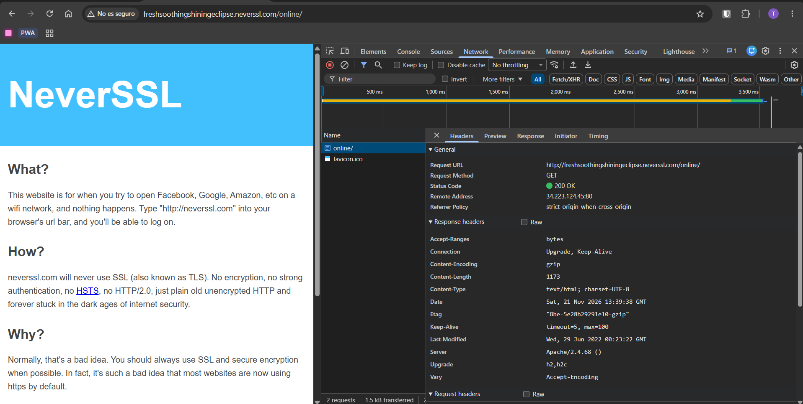
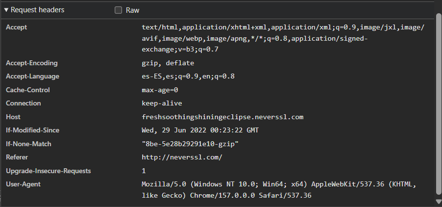

# Informe de Auditoría de Red Wi-Fi Insegura

> **Nota antes de subir:** guardá las capturas como `evidencia/network_neverssl.png` y `evidencia/request_headers.png`. Verificá que lo que dice la tabla coincida con ellas y después borrá esta nota.

## Introducción

Cuando nos conectamos a la Wi-Fi de una cafetería o un aeropuerto, compartimos el "aire" con decenas de desconocidos. En este informe actúo como auditor de seguridad junior: analizo qué información queda expuesta al navegar por un sitio que usa HTTP, explico qué riesgos implica hacerlo desde una red Wi-Fi pública y describo cómo una VPN ayuda a protegerse.

## Sitio analizado

- **Sitio:** `http://neverssl.com`. Al ingresar, el sitio me redirigió a un subdominio aleatorio (`freshsoothingshiningeclipse.neverssl.com/online/`), un comportamiento habitual de este sitio. Sigue siendo HTTP.
- **Protocolo utilizado:** **HTTP**, no HTTPS. La dirección empieza con `http://` y el navegador lo marca como "No seguro", porque la comunicación viaja **sin cifrar**.

Para el análisis abrí el sitio, abrí las herramientas de desarrollador del navegador (`F12`), seleccioné la pestaña **Network** (Red), recargué la página y examiné la primera solicitud.

## Evidencia observada

**Solicitud principal** (primera solicitud, `online/`), con el método, el código de respuesta y la dirección remota:

  

**Headers enviados por mi navegador** (*Request headers*):

  

| Dato | Valor observado |
|---|---|
| URL solicitada | `http://freshsoothingshiningeclipse.neverssl.com/online/` |
| Método HTTP | `GET` |
| Host | `freshsoothingshiningeclipse.neverssl.com` (subdominio de neverssl.com) |
| Protocolo | HTTP, sin cifrado, puerto 80 (la dirección remota es `34.223.124.45:80`) |
| Código de respuesta | `200 OK` |
| Respuesta del servidor | `Server: Apache/2.4.68`, `Content-Type: text/html; charset=UTF-8` |
| Headers enviados | `Accept`, `Accept-Encoding`, `Accept-Language`, `Cache-Control`, `Connection`, `Host`, `If-Modified-Since`, `If-None-Match`, `Referer`, `Upgrade-Insecure-Requests`, `User-Agent` |
| User-Agent | `Mozilla/5.0 (Windows NT 10.0; Win64; x64) AppleWebKit/537.36 (KHTML, like Gecko) Chrome/157.0.0.0 Safari/537.36` |

En la barra de direcciones, Chrome marca el sitio como **"No es seguro"**, justamente porque usa HTTP.

**Información visible durante la solicitud:** el host o dominio al que accedo, la URL y el recurso pedido, el método `GET` y los headers. Dentro de ellos, el `User-Agent` revela mi navegador (Chrome) y mi sistema operativo (Windows 10 de 64 bits), el `Accept-Language` muestra mi idioma (`es-ES`, español) y el `Referer` indica desde qué página llegué (`http://neverssl.com/`). Todo esto viaja en texto plano y cualquiera en la misma red podría leerlo.

## Riesgos encontrados

Navegar por HTTP desde una Wi-Fi pública es como enviar una postal escrita a mano: cualquiera que la toque puede leerla. Los principales riesgos son:

- **Intercepción de datos (sniffing):** alguien conectado a la misma red puede usar una herramienta como Wireshark para capturar los paquetes y leer su contenido, incluyendo los sitios que visito, las URL, los headers y el contenido de las páginas. Si enviara un formulario con usuario y contraseña por HTTP, esos datos también quedarían a la vista.
- **Robo de sesiones:** las cookies de sesión que viajan sin cifrar pueden copiarse para entrar a mis cuentas sin necesidad de mi contraseña.
- **Ataque de intermediario (Man-in-the-Middle):** un atacante puede hacer que mi dispositivo crea que él es el router, de modo que todo mi tráfico pase primero por su computadora. Además, podría modificar el contenido que recibo.
- **Redes gemelas malignas (Evil Twin):** una red con un nombre parecido al del local (por ejemplo, "Cafe_Gratis") puede ser un hotspot creado por un atacante para robar datos.
- **Pérdida de privacidad:** aunque no descargue nada, mis hábitos de navegación y mi identidad pueden quedar expuestos solo por visitar sitios inseguros.

Un error común es pensar que una red con contraseña es segura. Si esa clave se le entrega a todos los clientes, todos pueden intentar atacar a los demás usuarios de la red.

## Cómo ayuda una VPN

Una VPN (red privada virtual) crea un **túnel** seguro entre mi dispositivo y un servidor VPN. Funciona así:

- **Cifrado:** todo mi tráfico se cifra antes de salir de mi dispositivo.
- **Encapsulamiento:** los paquetes originales se encapsulan dentro de paquetes cifrados que viajan por el túnel, por lo que ni siquiera se ven los sitios a los que accedo.
- **Túnel seguro:** aunque un atacante capture los datos en la red pública, solo verá ruido cifrado ilegible.
- **Privacidad:** quien esté en la misma red ve únicamente que me conecto a un servidor VPN, y no mis destinos, mis headers ni el contenido de lo que envío.

**Límites:** la VPN no reemplaza a HTTPS. Desde el servidor VPN hasta el sitio de destino, el tráfico HTTP sigue viajando sin cifrar, y además tengo que confiar en el proveedor de la VPN. Por eso conviene combinar ambas protecciones.

## 3 Reglas de Oro para navegar en redes Wi-Fi públicas

1. **Usá siempre HTTPS y desconfiá de los sitios "No seguros".** Nunca ingreses contraseñas ni datos personales en una página HTTP.
2. **Conectate a través de una VPN de confianza.** Cifra el tráfico y evita que otros usuarios de la red lo lean.
3. **Verificá la red y evitá las operaciones sensibles.** Confirmá el nombre exacto de la red con el local para no caer en una red gemela, desactivá la conexión automática y no hagas banca ni trámites críticos desde una Wi-Fi pública: usá tus datos móviles.
